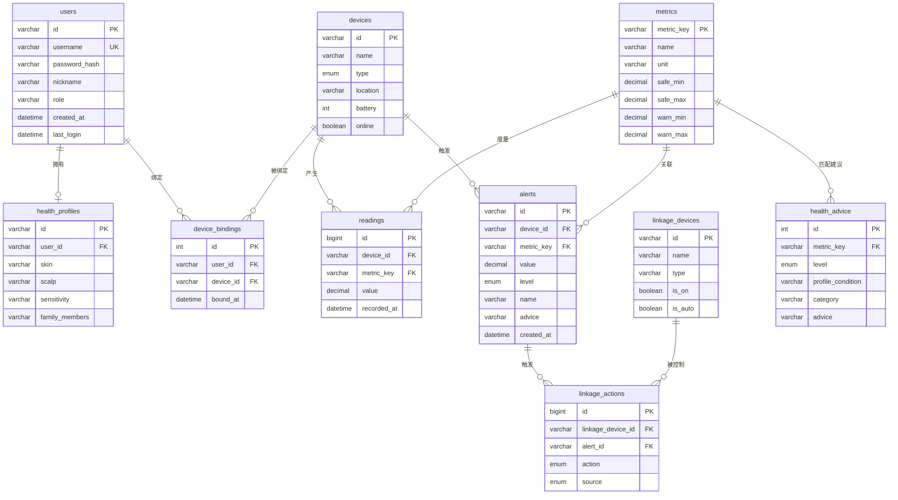

# 数据库设计 —— 家庭水质健康管理系统

> 本目录展示「水质—健康关联数据库」的关系型设计（申报书核心成果之一）。
>
> **诚实边界**：两套软著的实际实现为**轻量 JSON 文件持久化**（`server/store/db.js`，Node 内置 `fs` 落盘，无原生编译依赖、开箱即用），适合演示与单机部署。本目录给出的是**规模化后的关系型设计**——用于展示数据库设计能力，并支撑未来接入真实多用户/多设备场景（MySQL 落地 + SQLite 可运行验证）。

---

## 1. 实体关系图（ER Diagram）

---

## 2. 表清单与用途

| 表 | 用途 | 对应软著实际来源 |
|---|---|---|
| `users` | 用户账号 | `data/user.json` |
| `health_profiles` | 健康画像（皮肤/头皮/敏感点/家庭成员） | 前端健康画像视图（localStorage） |
| `devices` | 监测终端（固定式/便携式） | `data/device.json` |
| `device_bindings` | 用户↔设备多对多绑定 | 设备管理视图 |
| `metrics` | 水质指标字典（阈值/单位） | `server/config.js` 的 `METRICS` |
| `readings` | 水质时序读数 | `data/reading.json` |
| `alerts` | 分级预警记录 | `data/alert.json` |
| `linkage_devices` | 可联动设备（净水器/软水机/…） | `data/linkage.json` |
| `linkage_actions` | 联动控制动作日志 | `server/engine/linkageEngine.js` |
| `health_advice` | 健康建议库（规则引擎映射） | `server/engine/healthEngine.js` |

---

## 3. 文件说明

| 文件 | 内容 |
|---|---|
| `schema.sql` | **MySQL 兼容** DDL（建表 + 外键 + 索引） |
| `sqlite/schema.sqlite.sql` | SQLite 落地 DDL + 种子数据 |
| `sqlite/queries.sql` | 示例查询（对应指标体系的关键分析） |
| `sqlite/run.py` | Python 脚本：执行 schema + 查询，验证可运行并打印结果 |

> 运行验证：`python sqlite/run.py`（依赖 Python 内置 `sqlite3`，无需额外安装）。
